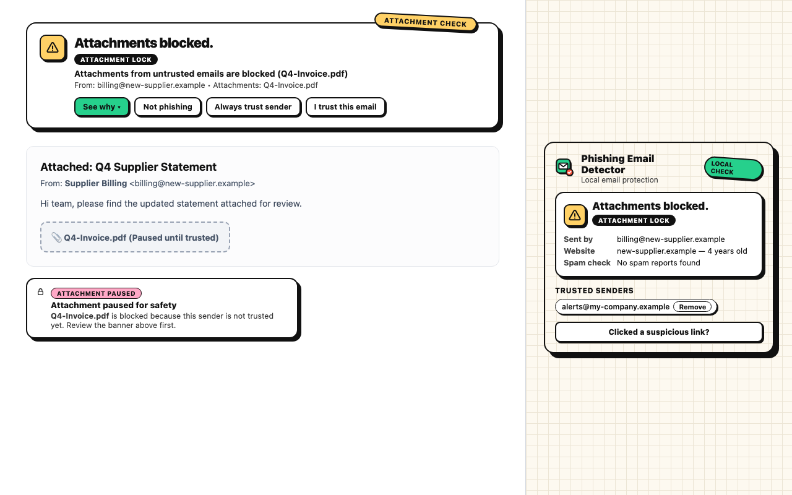

# Phishing Email Detector

[](https://github.com/Jrdelt/email/actions/workflows/ci.yml)
[](LICENSE)
[](extension/wxt.config.ts)

Privacy-first phishing email protection that runs locally in your browser. One TypeScript codebase ([WXT](https://wxt.dev), Manifest V3, `~176 kB` unpacked / `~68 kB` zipped, zero runtime npm dependencies) ships to **Chrome, Edge, and Firefox**, paired with a reproducible Python ML feature/training pipeline (`ml/`).

> **Project status:** Active development. Heuristic content scoring, sender/authentication checks, live domain intelligence, zero-permission link & attachment locking, and click-time destination protection are shipped (**T0–T1**). Calibrated time-split ML model training and in-extension JSON inference are tracked in [docs/ROADMAP.md](docs/ROADMAP.md) (**T2–T10**).

## Preview

| In-Page Phishing Alert & Locked Links | Click-Time Link Warning & Recovery Guide | Always-On Attachment Lock & Popup |
|---|---|---|
|  |  |  |

## Key Protections

- **Local content & sender analysis:** Detects brand impersonation (including compact/camelCase forms like `PayPalSupport`), lookalike/punycode domains, link-text vs. destination mismatches, raw cloud-storage HTML lures, urgency pretexts, unauthenticated senders, and suspicious `via` relays—all inside the browser.
- **Privacy-preserving domain intelligence & HIPAA Strict Local Mode:** Queries only validated registrable domains (never email bodies, sender addresses, or URL paths/queries) via RDAP, Cloudflare/Google DNS (`MX`, `SPF`, `DMARC`, `NXDOMAIN`), and URIBL—**or toggle Strict Local Mode** in the popup (or lock via enterprise Group Policy / Intune / `policies.json`) for **0 network requests** in HIPAA-regulated and air-gapped environments.
- **Hardened link & form locking:** Any content, sender, or domain warning pauses `<a>`, `<area>`, `<a ping>`, SVG `href`/`xlink:href`, `<form action>`, and `[formaction]` elements inside untrusted messages (with DOM-clobbering-safe attribute stashing and instant MutationObserver re-locking) without blocking reading the email.
- **Always-on attachment lock for untrusted mail:** Blocks webmail attachment shelves/cards and inline `download`/`data:`/`blob:` links on every untrusted email until explicitly trusted, flagging HTML/SVG smuggling, executables, scripts, macros, and double extensions locally by filename.
- **Click-time destination guard & recovery:** Flushes pending scans if a user clicks within the initial 400 ms debounce window, blocks Grabify/IP-logger links (`urlto.me`, `grabify.link`) and shorteners, unwraps multi-hop tracking redirects (Safe Links, Google, Facebook, YouTube), checks destination domain age/reputation, and routes risky clicks to a local `warning.html` interstitial and calm recovery checklist.
- **Usable, spoof-resistant trust controls:** Shows a `From` vs. `Links go to` comparison cue on the main card, requires 2-step confirmation to unlock `danger` alerts, disables `"Always trust sender"` when sender authentication fails, and remembers `"I trust this email"` as a one-way SHA-256 digest with one-click **Undo**.

## Supported Browsers & Webmail Providers

Ships native Manifest V3 builds for **Chrome**, **Edge**, and **Firefox (142+)** — and runs seamlessly in **Brave**, **Vivaldi**, **Arc**, **Opera**, and **Safari** (via Xcode converter). See [docs/browser-support-and-stores.md](docs/browser-support-and-stores.md).

| Provider | Host(s) | Status | Notes |
|---|---|---|---|
| **Gmail / Google Workspace** | `mail.google.com` | Supported | Zero Gmail OAuth scopes; `via`/unauthenticated header checks; attachment shelf & inline lock |
| **Outlook Web / Microsoft 365** | `outlook.live.com`, `outlook.office.com`, `outlook.office365.com`, `outlook.cloud.microsoft` | Supported | Reading Pane + iframe extraction, Safe Links unwrapping, attachment card lock |
| **Apple iCloud Mail** | `www.icloud.com/mail/*` (+ scoped `mail2` & `icloud-sandbox` frames) | Supported | Stateless `sender.url`-verified cross-frame coordination (never touches Photos/Drive) |
| **Yahoo Mail** | `mail.yahoo.com` | Supported | Message body + iframe fallback extraction, compose exclusion, attachment tile lock |
| **Proton Mail** | `mail.proton.me` | Supported | Read-only inspection on locally decrypted DOM (`content-iframe` / message body); PGP keys untouched |

## Architecture

```text
Webmail tab (Gmail, Outlook Web, iCloud Mail, Yahoo Mail, Proton Mail)
  └─ Content script (extension/entrypoints/content.ts)
       ├─ Per-provider DOM adapter (extension/src/adapters/*)
       ├─ Local scorer + sender/attachment checks (features.ts, sender.ts, attachments.ts)
       ├─ 400 ms pending-scan click gate + DOM-clobbering-safe link/attachment locks
       ├─ Click-time destination inspector (linkGuard.ts) -> session token -> warning.html
       └─ Closed Shadow DOM banner & paused-action toast (extension/src/ui/*)
            │
            ▼
  Background service worker / script (extension/entrypoints/background.ts)
       ├─ Domain-only RDAP + DNS + URIBL lookups (disabled when Strict Local Mode is on)
       ├─ Enterprise policy enforcement (managed_schema.json via storage.managed)
       ├─ Ephemeral 1 h warning.html session store (browser.storage.session)
       └─ Stateless sender.url-verified iCloud Mail frame relay

Offline ML pipeline (ml/src/phishml/*, Python 3.11+ / uv)
  └─ Exact feature parity with TypeScript verified via ml/tests/fixtures/parity.json
```

## Quick Start

### Build & Run Tests

Requires **Node.js 22+** and **Python 3.11+** with [`uv`](https://docs.astral.sh/uv/).

```sh
# Browser extension
cd extension
npm ci
npm run typecheck
npm test
npm run build:all      # Builds Chrome, Edge, and Firefox MV3 bundles (+ syncs ../chrome-mv3/)

# Python ML pipeline & cross-language parity suite
cd ../ml
uv sync --locked
uv run pytest
```

### Load Unpacked in Your Browser

- **Chrome / Brave / Chromium:** Run `npm run build` in `extension/`, open `chrome://extensions`, enable **Developer mode**, click **Load unpacked**, and select the repo-root `chrome-mv3/` directory.
- **Microsoft Edge:** Run `npm run build:edge` in `extension/`, open `edge://extensions`, enable **Developer mode**, click **Load unpacked**, and select `extension/.output/edge-mv3/`.
- **Firefox (142+):** Run `npm run build:firefox` in `extension/`, open `about:debugging#/runtime/this-firefox`, click **Load Temporary Add-on…**, and select `extension/.output/firefox-mv3/manifest.json`.

## Repository Layout

| Path | Description |
|---|---|
| [`extension/`](extension/) | WXT + TypeScript Manifest V3 extension (`src/`, `entrypoints/`, `public/managed_schema.json`) |
| `chrome-mv3/` | Gitignored unpacked Chrome MV3 build synced automatically on `npm run build` |
| [`ml/`](ml/) | Python feature extraction, parity fixtures, and upcoming model training (`uv`) |
| [`docs/`](docs/) | [browser-support-and-stores.md](docs/browser-support-and-stores.md), [hipaa-and-compliance.md](docs/hipaa-and-compliance.md), [privacy.md](docs/privacy.md), [threat-model.md](docs/threat-model.md), [ROADMAP.md](docs/ROADMAP.md), [research-defense-in-depth.md](docs/research-defense-in-depth.md) |
| Community & Store | [CONTRIBUTING.md](CONTRIBUTING.md), [SECURITY.md](SECURITY.md), [CHROMEWEBSTORE.md](CHROMEWEBSTORE.md), [LICENSE](LICENSE) |

## Privacy & HIPAA Compliance

Email bodies, attachment files/filenames, full URLs, paths, query strings, `#fragments`, and sender email addresses **never leave your browser**. In Standard Mode, only validated registrable domains are queried against public RDAP and DNS services (`credentials: 'omit'`, cached locally for 24 hours). For HIPAA-regulated or strict zero-egress organizations, **Strict Local Mode** (user-toggleable in the popup or locked by IT via `managed_schema.json`) disables 100% of external network lookups. See [docs/privacy.md](docs/privacy.md), [docs/hipaa-and-compliance.md](docs/hipaa-and-compliance.md), and [docs/threat-model.md](docs/threat-model.md).

## Authorized Use & Security

Test only with emails and pages you own or have permission to analyze. To report a security or privacy vulnerability, please follow [SECURITY.md](SECURITY.md).

## License

Released under the [MIT License](LICENSE).
