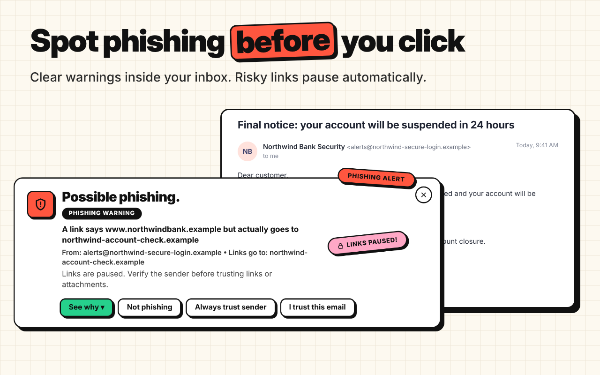
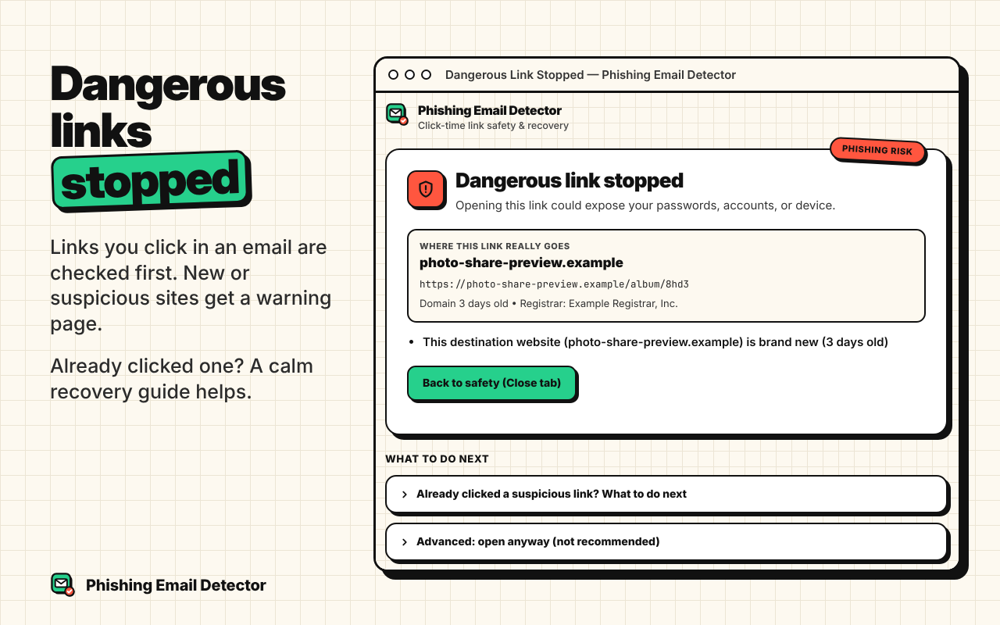
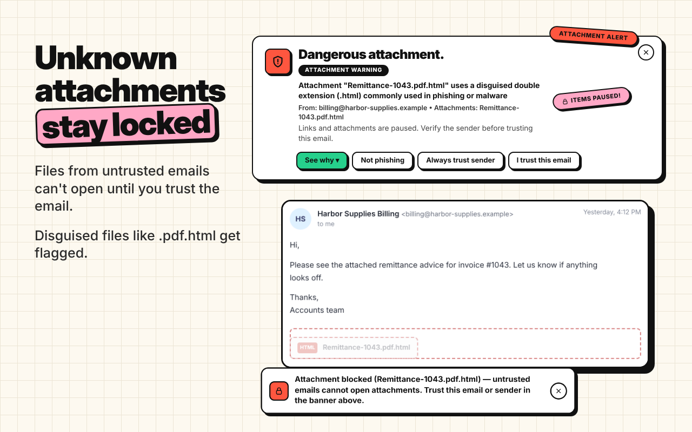

# Phishing Email Detector

[](https://github.com/Jrdelt/email/actions/workflows/ci.yml)
[](LICENSE)
[](extension/wxt.config.ts)

Privacy-first phishing email protection that runs locally in your browser. One TypeScript codebase ([WXT](https://wxt.dev), Manifest V3, `~237 kB` unpacked / `~92 kB` zipped, zero runtime npm dependencies) ships to **Chrome, Edge, and Firefox** on desktop computers, paired with a Python feature-extraction and parity-test package (`ml/`); model training is planned (**T2–T5**).

> **Project status:** Active development. Heuristic content scoring, sender/authentication checks, live domain intelligence, zero-permission link & attachment locking, and click-time destination protection are shipped (**T0–T1**). Calibrated time-split ML model training and in-extension JSON inference are tracked in [docs/ROADMAP.md](docs/ROADMAP.md) (**T2–T10**).

## Preview

Real screenshots of the extension on an invented webmail page (made-up `.example` names; the same images as the store listing, from [store/graphics/](store/graphics/)).

| In-Page Phishing Alert & Paused Links | Click-Time Link Warning & Recovery Guide | Attachment Lock for Untrusted Email |
|---|---|---|
|  |  |  |

## Key Protections

- **Local content & sender analysis:** Detects brand impersonation (including compact/camelCase forms like `PayPalSupport`, brand names written with look-alike letters, and brands' own sender names such as `Apple ID`), look-alike sender domains (one-letter changes, swapped letters like `mircosoft`, brand-plus-word combinations like `paypal-secure`, and a brand's domain used inside another domain), punycode domains, link-text vs. destination mismatches, raw cloud-storage HTML lures, and urgency pretexts—all inside the browser. Unauthenticated senders and suspicious `via` relays are read from Gmail only, and only when Gmail's interface is in English (see the provider table).
- **Privacy-preserving domain intelligence & HIPAA Strict Local Mode:** Looks up only validated registrable domains (never email bodies, sender addresses, or URL paths/queries) via RDAP (registration age and registrar) and Cloudflare DNS (`MX`, `SPF`, `DMARC`, `NXDOMAIN`)—**or toggle Strict Local Mode** in the popup (or lock it via enterprise Group Policy / Intune / `policies.json`) for **0 network requests** in HIPAA-regulated and air-gapped environments.
- **Hardened link & form locking:** Any content, sender, or domain warning pauses `<a>`, `<area>`, `<a ping>`, SVG `href`/`xlink:href` (including links reached through SVG `<use>`), `<form action>`, and `[formaction]` elements inside the flagged message (with DOM-clobbering-safe attribute stashing and instant MutationObserver re-locking) without blocking reading the email.
- **Attachment lock for untrusted mail:** Blocks webmail attachment shelves/cards and inline downloads (`download`/`data:`/`blob:` links, and forms that submit to a `data:`/`blob:` URL) in every opened email you have not trusted yet (plus file buttons on Gmail's inbox list), flagging HTML/SVG smuggling, executables, scripts, macros, risky Windows file types (`.rdp`, `.iqy`, `.searchConnector-ms`, ...), archives, and double extensions locally by filename.
- **Click-time destination guard & recovery:** Holds a click or form submission made before the email's first scan (400 ms) has finished until that scan is done, blocks Grabify/IP-logger links (`urlto.me`, `grabify.link`), unwraps redirect and link-protection wrappers (Microsoft Safe Links, Proofpoint, Barracuda, Cisco Secure Email, Google `/url` on Google's country domains, Google AMP, Bing, Facebook, YouTube), warns about URL shorteners, sites on free hosting services (`pages.dev`, `netlify.app`, `github.io`, ...), archive downloads and unencrypted `http://` links, checks the destination domain's age and registration, and routes risky clicks to a local `warning.html` interstitial and calm recovery checklist.
- **Usable, spoof-resistant trust controls:** Shows a `From` vs. `Links go to` comparison cue on the main card, asks for confirmation before `"I trust this email"` or `"Always trust sender"` acts on a high-risk (`danger`) alert, disables `"Always trust sender"` when sender authentication fails, remembers `"I trust this email"` as a one-way SHA-256 digest with one-click **Undo**, and applies trust given in one tab to your other open webmail tabs.

## Supported Browsers & Webmail Providers

Ships native Manifest V3 builds for desktop **Chrome**, **Edge**, and **Firefox (142+)**. Chromium-based browsers (**Brave**, **Vivaldi**, **Arc**, **Opera**) can install the Chrome build, but are not tested separately. **Safari** and **Firefox for Android** have never been built or tested and are not supported yet: the adapters target desktop webmail pages. See [docs/browser-support-and-stores.md](docs/browser-support-and-stores.md).

| Provider | Host(s) | Status | Notes |
|---|---|---|---|
| **Gmail / Google Workspace** | `mail.google.com` | Supported | Zero Gmail OAuth scopes; `via`/unauthenticated sender checks (English Gmail interface only); attachment shelf & inline lock; inbox-list file-button guard |
| **Outlook Web / Microsoft 365** | `outlook.live.com`, `outlook.office.com`, `outlook.office365.com`, `outlook.cloud.microsoft` | Supported | Reading Pane + iframe extraction, Safe Links unwrapping, attachment card lock in opened emails; Outlook's sender verification is not read and message-list file buttons are not guarded |
| **Apple iCloud Mail** | `www.icloud.com/mail/*` (+ scoped `mail2` & `icloud-sandbox` frames) | Supported | Stateless `sender.url`-verified cross-frame coordination (never touches Photos/Drive); sender verification is not read |
| **Yahoo Mail** | `mail.yahoo.com` | Supported | Message body + iframe fallback extraction, compose exclusion, attachment tile lock in opened emails; sender verification is not read and message-list file buttons are not guarded |
| **Proton Mail** | `mail.proton.me` | Supported | Works on the already-decrypted message view (`content-iframe` / message body): pauses links and attachments there, never reads keys or calls Proton APIs; sender verification is not read and message-list file buttons are not guarded |

## Architecture

```text
Webmail tab (Gmail, Outlook Web, iCloud Mail, Yahoo Mail, Proton Mail)
  └─ Content script (extension/entrypoints/content.ts)
       ├─ Per-provider DOM adapter (extension/src/adapters/*)
       ├─ Local scorer + sender/attachment checks (features.ts, sender.ts, attachments.ts)
       ├─ 400 ms pending-scan click gate + DOM-clobbering-safe link/attachment locks
       ├─ Click-time destination inspector (linkGuard.ts) -> session token -> warning.html
       └─ Closed Shadow DOM banner & paused-action toast (extension/src/ui/*)
            │
            ▼
  Background service worker / script (extension/entrypoints/background.ts)
       ├─ Domain-only RDAP + DNS lookups (disabled when Strict Local Mode is on)
       ├─ Enterprise policy enforcement (managed_schema.json via storage.managed)
       ├─ Short-lived warning.html entries (browser.storage.session; removed on back/proceed/tab close, pruned after 1 h)
       └─ Stateless sender.url-verified iCloud Mail frame relay

Offline ML package (ml/src/phishml/*, Python 3.13 pinned by ml/.python-version / uv)
  └─ Feature parity with TypeScript tested on the shared fixtures in ml/tests/fixtures/ (parity.json, scoring_input.json)
```

## Quick Start

### Build & Run Tests

Requires **Node.js 22.12+ or 24+** (not 23 or 25; `package.json` `engines`) and [`uv`](https://docs.astral.sh/uv/), which installs the Python version pinned in `ml/.python-version` (3.13) for you.

```sh
# Browser extension
cd extension
npm ci
npm run typecheck
npm test
npm run build:all      # Builds Chrome, Edge, and Firefox MV3 bundles (+ syncs ../chrome-mv3/)

# Python ML pipeline & cross-language parity suite
cd ../ml
uv sync --locked
uv run pytest
```

### Load Unpacked in Your Browser

- **Chrome / Brave / Chromium:** Run `npm run build` in `extension/`, open `chrome://extensions`, enable **Developer mode**, click **Load unpacked**, and select the repo-root `chrome-mv3/` directory.
- **Microsoft Edge:** Run `npm run build:edge` in `extension/`, open `edge://extensions`, enable **Developer mode**, click **Load unpacked**, and select `extension/.output/edge-mv3/`.
- **Firefox (142+, desktop):** Run `npm run build:firefox` in `extension/`, open `about:debugging#/runtime/this-firefox`, click **Load Temporary Add-on…**, and select `extension/.output/firefox-mv3/manifest.json`.

## Repository Layout

| Path | Description |
|---|---|
| [`extension/`](extension/) | WXT + TypeScript Manifest V3 extension (`src/`, `entrypoints/`, `public/managed_schema.json`) |
| `chrome-mv3/` | Gitignored unpacked Chrome MV3 build synced automatically on `npm run build` |
| [`ml/`](ml/) | Python feature extraction, parity fixtures, and upcoming model training (`uv`) |
| [`store/`](store/) | Store listing text and graphics ([store/README.md](store/README.md)) |
| [`docs/`](docs/) | [browser-support-and-stores.md](docs/browser-support-and-stores.md), [hipaa-and-compliance.md](docs/hipaa-and-compliance.md), [privacy.md](docs/privacy.md), [threat-model.md](docs/threat-model.md), [ROADMAP.md](docs/ROADMAP.md), [research-defense-in-depth.md](docs/research-defense-in-depth.md) |
| Community & Store | [CONTRIBUTING.md](CONTRIBUTING.md), [SECURITY.md](SECURITY.md), [CHROMEWEBSTORE.md](CHROMEWEBSTORE.md), [LICENSE](LICENSE) |

## Privacy & HIPAA Compliance

Email bodies, attachment files/filenames, full URLs, paths, query strings, `#fragments`, and sender email addresses **never leave your browser**. In Standard Mode, only validated registrable domains are queried against public RDAP and Cloudflare DNS services (`credentials: 'omit'`, cached locally for 24 hours; like any browser request, the services also see your IP address and standard request headers, including an `Origin` header that names the extension). For HIPAA-regulated or strict zero-egress organizations, **Strict Local Mode** (user-toggleable in the popup or locked by IT via `managed_schema.json`) disables 100% of external network lookups. See [docs/privacy.md](docs/privacy.md), [docs/hipaa-and-compliance.md](docs/hipaa-and-compliance.md), and [docs/threat-model.md](docs/threat-model.md).

## Known Limits

No tool catches every scam. Things the extension does not do today (details in [docs/threat-model.md](docs/threat-model.md)):

- **Image-only emails:** an email that is just one linked picture has no text to score, so only the click-time check of the link's domain applies.
- **App links:** links that open a program instead of a web page (`search-ms:`, `ms-msdt:`, `ms-word:`, `msteams:`, ...) are neither scored nor checked when clicked.
- **Opening a link without clicking it:** the browser's own "Open link in new tab", "Copy link address" or dragging a link to the tab bar skip the click-time check on emails that are not flagged. (In a flagged email the paused links have no address left to open.)
- **Sender verification outside English Gmail:** a forged copy of a trusted sender's address cannot be spotted there; its attachments stay locked until you trust that email.
- **iCloud Mail:** if iCloud changes its page so the extension cannot find the open message's header, that message is not scored; its links still get the click-time check.

## Authorized Use & Security

Test only with emails and pages you own or have permission to analyze. To report a security or privacy vulnerability, please follow [SECURITY.md](SECURITY.md).

## License

Released under the [MIT License](LICENSE).
