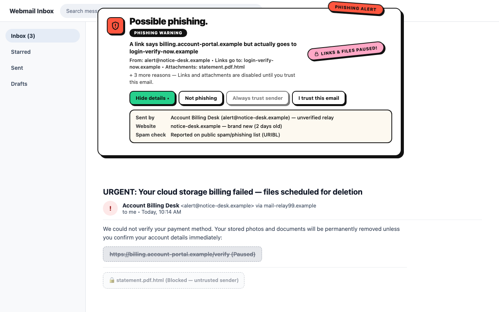
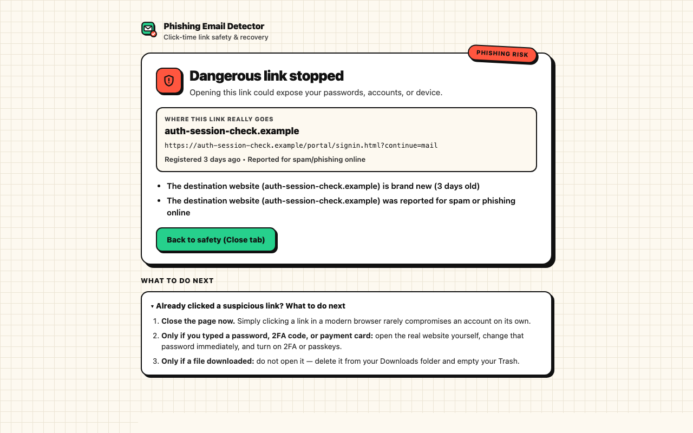

# Phishing Email Detector

[](https://github.com/Jrdelt/email/actions/workflows/ci.yml)
[](LICENSE)
[](extension/wxt.config.ts)

Phishing Email Detector is a browser extension that warns you about phishing while you read webmail. It checks each email inside your browser, pauses risky links and attachments, and explains why. Email content never leaves your browser. It is built with TypeScript and [WXT](https://wxt.dev) as a Manifest V3 (the current extension format) extension for Chrome, Edge and Firefox. The `ml/` folder holds a Python pipeline for a planned machine-learning model.

| Phishing alert and paused links | Click-time link warning | Attachment lock and popup |
|---|---|---|
|  |  |  |

## What it does

- **Spots phishing tricks:** brand impersonation (including squashed names like `PayPalSupport`), lookalike and punycode domains (look-alike or non-Latin letters), link text that differs from the real destination, pages hosted on raw cloud storage, and urgent "act now" wording.
- **Checks the sender:** invalid or forged-looking addresses, a fake address in the display name, senders the webmail could not verify, and suspicious "via" relays.
- **Looks up domains, never emails:** only the bare domain (like `example.com`) of the sender or a clicked link. RDAP (public domain-registration data) gives the domain's age. Cloudflare DNS gives mail records (MX, SPF, DMARC) and whether the domain exists (NXDOMAIN). URIBL (a public spam list) is checked through Cloudflare, with Google DNS as a fallback. No cookies or credentials are sent, and results are cached for 24 hours.
- **Strict Local Mode:** for HIPAA (US health privacy law) and no-network setups. A switch in the popup turns off all lookups, so the extension makes zero network requests. IT can lock it on with Group Policy, Intune or Firefox `policies.json`.
- **Pauses links and forms:** any warning locks links, image-map areas, "ping" trackers, SVG links, form actions and `formaction` buttons, including content added later. You can still read the email.
- **Blocks attachments from untrusted emails:** always, until you trust the email or sender. File names are checked for HTML/SVG smuggling (web files that hide a fake page or download), executables, scripts, macro-enabled Office files and double extensions like `invoice.pdf.exe`. Inline `download`, `data:` and `blob:` links are blocked too.
- **Checks links when you click:** blocks IP loggers like Grabify, flags URL shorteners, unwraps Microsoft Safe Links, Google, Facebook and YouTube redirects, and (when lookups are on) checks the destination's domain age and reputation. Risky clicks open a local warning page with recovery steps.
- **Hard-to-fake trust:** trust is per exact address, never per domain or display name. "Always trust sender" is disabled for unverified senders and suspicious relays. High-risk alerts need a second click to unlock, and trusting an email can be undone.

## Supported browsers and webmail

Builds: **Chrome**, **Microsoft Edge** and **Firefox 142+**. Other Chromium browsers (Brave, Vivaldi, Arc, Opera) can use the Chrome build; Safari needs Apple's Xcode converter. See [browser support and stores](docs/browser-support-and-stores.md).

| Webmail | Web address |
|---|---|
| Gmail and Google Workspace | `mail.google.com` |
| Outlook on the web and Microsoft 365 | `outlook.live.com`, `outlook.office.com`, `outlook.office365.com`, `outlook.cloud.microsoft` |
| iCloud Mail | `www.icloud.com/mail` (plus its mail-only frames) |
| Yahoo Mail | `mail.yahoo.com` |
| Proton Mail | `mail.proton.me` |

The only permissions are `storage` and access to these sites. The extension reads the page you already see, so it needs no Google or Microsoft account access (OAuth scopes).

## Load Unpacked in Your Browser

You need [Node.js](https://nodejs.org) 22 or later. First run:

```sh
cd extension
npm ci
```

- **Chrome** (and other Chromium browsers): run `npm run build`. Open `chrome://extensions`, turn on **Developer mode**, click **Load unpacked**, and select the `chrome-mv3/` folder at the repo root.
- **Edge:** run `npm run build:edge`. Open `edge://extensions`, turn on **Developer mode**, click **Load unpacked**, and select `extension/.output/edge-mv3/`.
- **Firefox 142+:** run `npm run build:firefox`. Open `about:debugging#/runtime/this-firefox`, click **Load Temporary Add-on…**, and select `extension/.output/firefox-mv3/manifest.json`. Firefox removes temporary add-ons when it restarts.

Then open an email in a supported webmail and click the toolbar icon to see the result.

## Build and test

You need Node.js 22+, Python 3.11+ and [uv](https://docs.astral.sh/uv/) (a Python project manager).

```sh
cd extension
npm ci
npm run typecheck   # TypeScript type check
npm test            # unit tests (Vitest)
npm run build:all   # Chrome, Edge and Firefox builds

cd ../ml
uv sync --locked
uv run pytest       # includes TypeScript/Python feature parity tests
```

CI (GitHub Actions) runs these on every push and pull request, builds the store ZIPs (`npm run zip:all`), and fails if any build reaches 500 KB. Each build is about 210 kB today.

## Privacy

Email text, attachments and their names, sender addresses and full link addresses never leave your browser, and there are no accounts, analytics or developer-run servers. With Strict Local Mode off, the only network traffic is the domain-only lookups above: IANA and registry RDAP servers (with an `rdap.org` fallback), `cloudflare-dns.com`, `dns.google` and URIBL (queried through DNS), sent without credentials and cached for 24 hours. With Strict Local Mode on, there are no network requests at all. See the [privacy policy](docs/privacy.md), [HIPAA notes](docs/hipaa-and-compliance.md) and [threat model](docs/threat-model.md).

## Project status

Active development, version 0.1.0.

- **Shipped:** rule-based scoring, sender checks, domain lookups, Strict Local Mode with enterprise policy, link/form/attachment locking, the click-time link check, adapters for all five webmail services (unit-tested on synthetic pages), and TypeScript/Python feature parity tests (T1).
- **On the [roadmap](docs/ROADMAP.md):** train and evaluate a model on public data with a time-based split (T2–T4), run it in the extension from a small JSON file (T5–T6), verify adapters in live inboxes (T7), plain-language model reasons (T8), evasion tests and a speed benchmark (T9–T9b), and store release (T10).

## Documentation

| Document | What it covers |
|---|---|
| [Architecture](docs/architecture.md) | How it works: diagram and code map |
| [Privacy policy](docs/privacy.md) | What is processed, stored and sent |
| [HIPAA and compliance](docs/hipaa-and-compliance.md) | Strict Local Mode, enterprise policy, provider notes |
| [Threat model](docs/threat-model.md) | Attacks covered and known limits |
| [Browser support and stores](docs/browser-support-and-stores.md) | Browsers and store requirements |
| [Defense-in-depth research](docs/research-defense-in-depth.md) | Research and sources behind the design |
| [Roadmap](docs/ROADMAP.md) | Tasks and acceptance criteria |
| [Contributing](CONTRIBUTING.md) | Setup, checks and project rules |
| [Store listing](CHROMEWEBSTORE.md) | Chrome Web Store and Edge Add-ons listing text |
| [Agent rules](AGENTS.md) | Rules for AI coding agents in this repo |

## Security

Only test with emails and pages you own or may analyze. Report security or privacy problems privately as described in [SECURITY.md](SECURITY.md), not in public issues.

## License

[MIT](LICENSE)
